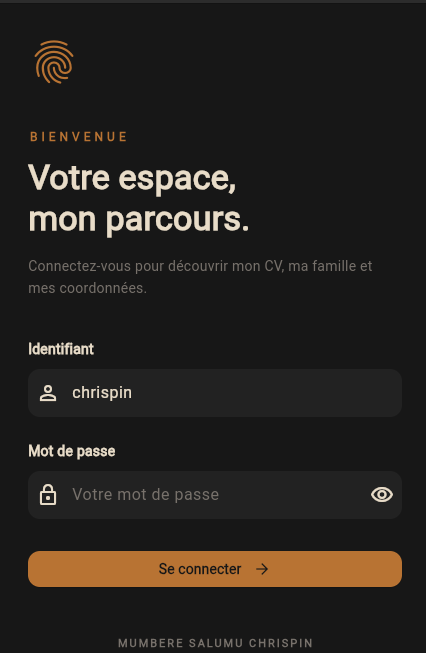
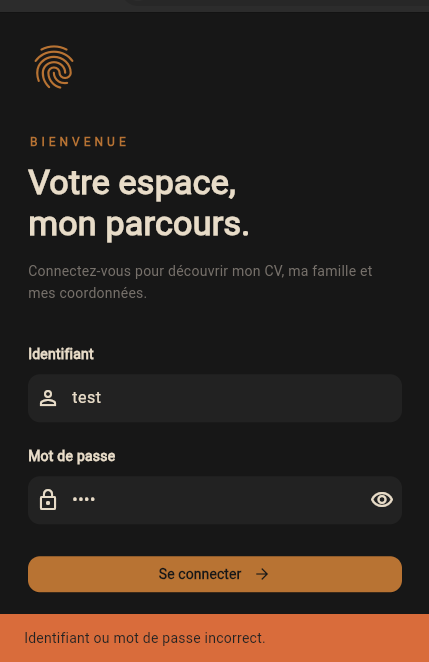
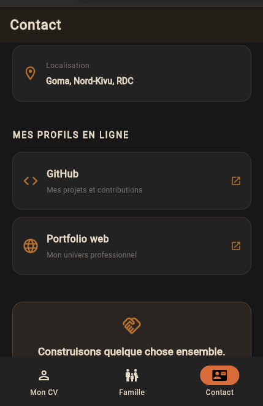
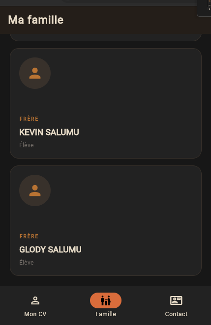
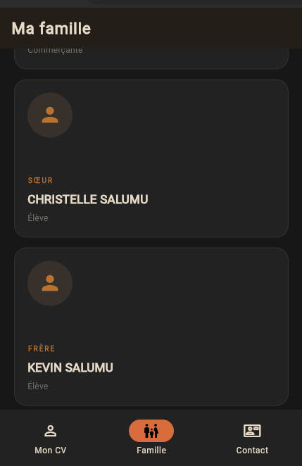
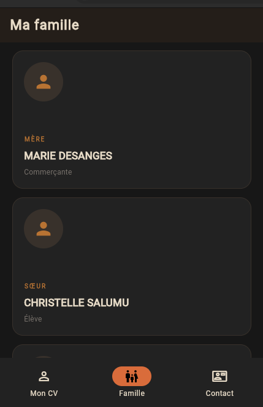
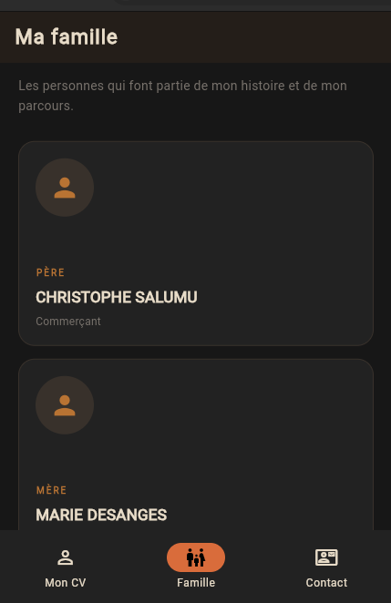
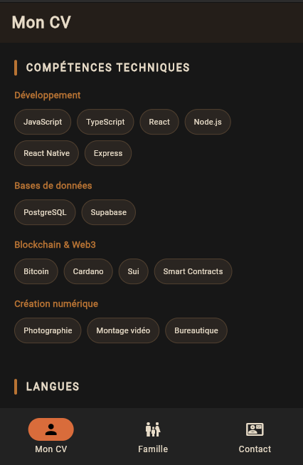
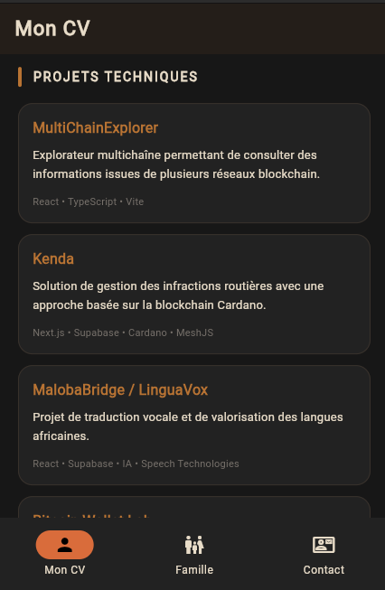

# CV de Chrispin Mumbere

Application mobile présentant mon parcours, mes compétences, mes projets, ma famille et mes coordonnées.

## Structure

- `lib/screens/` : écrans de connexion, CV, famille et contact.
- `lib/data/` : données du CV et des membres de la famille.
- `lib/models/` : modèle des membres de la famille.
- `lib/core/theme/` : thème et palette de couleurs.
- `assets/images/` : photo de profil et images du projet.

## Lancement

```bash
flutter pub get
flutter run
```

## Images


### Galerie

| | | |
|---|---|---|
|  |  |  |
|  |  |  |
|  |  |  |
|  |  |  |
|  | | |


